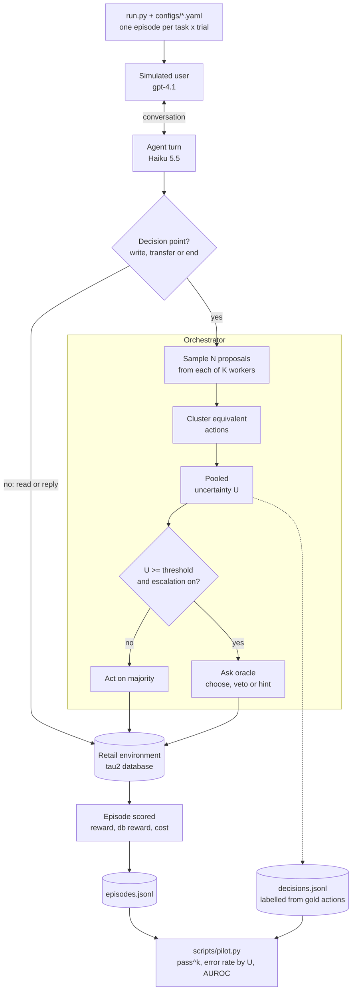

# swarm-uncertainty

Does an orchestrator's aggregated uncertainty predict wrong actions in an LLM agent team,
and when should it hand a decision to a human? A testbed on
[tau-bench](https://github.com/sierra-research/tau2-bench) (tau2-bench v1.0.1).

The team is one orchestrator and K workers. At each state-changing action the orchestrator
samples N proposals from every worker, measures how much they agree, and either acts on the
majority or escalates to an oracle. With K=1, N=1 this is a plain single agent, so every
condition runs through the same code.



## Setup

```bash
uv sync
scripts/get_data.sh        # tau-bench task data into ./data
cp .env.example .env       # API keys and TAU2_DATA_DIR
uv run pytest
```

## Run

```bash
uv run python run.py configs/s1.yaml --tasks 10    # first 10 tasks; omit for the whole split
```

Output goes to `runs/<name>/`: `episodes.jsonl`, `decisions.jsonl` and full trajectories in
`sims/`. Retail tasks are graded by database state and, for 112 of 114, by tau2's LLM judge,
which is fixed to `gpt-4.1` and needs `OPENAI_API_KEY`. `db_reward` is the database part alone.

| config | N | escalation |
|---|---|---|
| s0 | 1 | off |
| s1 | 5 | off, logged only (shadow) |
| s2 | 5 | to the answer key |

Worker: Claude Haiku 5.5. Simulated user: gpt-4.1, as in tau2's published baselines.

## Layout

```
src/swarm_uncertainty/
  actions.py        proposed actions and the equivalence rule
  measures.py       agreement, pooled uncertainty, disagreement, entropy
  llm.py            model client interface and a scripted fake
  orchestrator.py   decision loop: sample, cluster, act or escalate
  agent.py          tau2 agent that sends decision points through the loop
  episode.py        one task x trial: build environment, user and agent, run, score
  oracle.py         oracles the orchestrator can consult
  records.py        one record per decision point
  metrics.py        auroc, calibration, risk-coverage, pass^k
  config.py         run configuration
  tasks.py          tau-bench task loading
configs/            one yaml per condition
scripts/            data download
tests/
run.py
```

Tests run offline: the model calls are scripted, including one full retail episode.
